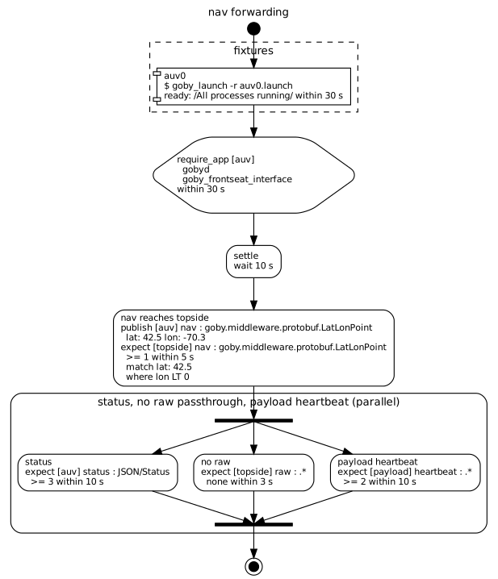

# goby-cli: Command Line Tool

The `goby` command line tool is a starting point for managing, running, and understanding a Goby system from the Linux command line.

Like many modern tools (e.g., git) is has many sub-commands that allow you to access a wealth of functionality from a simple natural language syntax with built-in help.

The `goby` tool is available if you install from the `goby3-apps` package or build from source.

## goby help

The help command gives information on any subcommand. For example:

```
goby help zeromq
```

gives help on the zeromq command.

## goby log

This function is useful for post-mission analysis of .goby log files written by `goby_logger`.

### goby log convert

Converts a .goby log file into useful formats: HDF5, JSON, etc. See the [goby_logger](doc504_goby_logger.md) page for more details.

## goby launch

`goby launch` is a basic process manager. It launches a number of Goby application at once in series from a single `.launch` file. At its simplest, a .launch file is simply a list of commands to execute

```
gobyd
goby_logger --log_dir=/var/log/goby
goby_liaison
```

`goby launch` runs them in a [screen](https://www.gnu.org/software/screen/) session by default. You can type CTRL-C to quit, using `goby_terminate` by default.

See `goby help launch` for more options.

## goby test

Runs declarative publish/subscribe tests against a Goby system, for example in CI or after a deployment, without writing a Goby application. It has three actions:

```
goby test run <test file> [-D NAME=value] [-o HUMAN|JSON] [--output_file <path>] [--log_dir <dir>] [-l <shared library>]
goby test validate <test file> [-D NAME=value] [-o HUMAN|JSON] [-l <shared library>]
goby test visualize <test file> [-D NAME=value] [--output_file <file.dot>]
```

- `run` starts the test's fixtures, runs the test and stops the fixtures. It exits 0 when every expectation passed, 1 when one failed, and 2 when the test could not run (an invalid file, a fixture that never became ready, an endpoint that could not connect, a required application that never responded, or an interruption).
- `validate` checks the file without connecting to anything and lists every problem with its location (such as `test.run[2].expect[0].match`). It exits 0 when the file is valid and 1 otherwise. `run` performs the same checks first.
- `visualize` writes the test plan as a Graphviz graph, e.g. `goby test visualize nav.yml | dot -Tpng -o nav.png`.

The test file is YAML (`.yml`/`.yaml`), JSON (`.json`) or Protobuf TextFormat (any other extension). Its fields are the `TestFile` message in `goby/apps/middleware/test_tool/test_tool_config.proto`, with the test itself in `goby/middleware/protobuf/pubsub_test.proto`. YAML requires Goby built with yaml-cpp (`libyaml-cpp-dev`; `-Denable_yaml=ON`, the default when found).

### Test file

```yaml
endpoint:
  - { name: auv, zeromq: { platform: auv0 } }
  - { name: topside, zeromq: { platform: "${TOPSIDE:-topside}", transport: TCP, ipv4_address: 10.0.0.5 } }
  - { name: payload, udpm: { platform: auv0, multicast_port: 11150 } }

fixture:
  - name: auv0
    command: goby_launch -r auv0.launch
    cwd: ../launch
    ready: { output_regex: "All processes running", timeout: 30 }

test:
  name: nav forwarding
  default_timeout: 5
  require_app:
    - { endpoint: auv, name: [gobyd, goby_frontseat_interface], timeout: 30 }
  run:
    - { name: settle, wait: 10 }
    - name: nav reaches topside
      publish:
        - { endpoint: auv, group: nav, type: goby.middleware.protobuf.LatLonPoint, value: "lat: 42.5 lon: -70.3" }
      expect:
        - endpoint: topside
          group: nav
          type: goby.middleware.protobuf.LatLonPoint
          match: "lat: 42.5"
          condition: [{ field: lon, op: LT, value: 0 }]
    - name: status, no raw passthrough, payload heartbeat
      mode: PARALLEL
      step:
        - name: status
          expect: [{ endpoint: auv, group: status, type: JSON/Status, min_count: 3, timeout: 10 }]
        - name: no raw
          expect: [{ endpoint: topside, group: raw, count: 0, timeout: 3 }]
        - name: payload heartbeat
          expect: [{ endpoint: payload, group: heartbeat, min_count: 2, timeout: 10 }]
```



- `endpoint`: named connections, each with `zeromq` settings (one `gobyd`) or `udpm` settings (one multicast group), on the interprocess (`LAYER_INTERPROCESS`, the default) or intermodule (`LAYER_INTERMODULE`) layer. A test may mix transports. An endpoint with neither uses zeromq when Goby was built with it, otherwise udpm; with no endpoints, one named `default` is created. Endpoint settings are layered over `run`'s `--zeromq` (also `GOBY_INTERPROCESS`) and `--udpm` settings.
- `fixture`: commands (run with `/bin/sh -c`, in `cwd`, each in its own process group) started in order before the test, each waiting until it is `ready`: a line of output matching `output_regex` within `timeout`, then an optional `delay`. After the test they are stopped in reverse order with `stop.signal` (default `SIGINT`), escalating to `SIGTERM` and `SIGKILL` after `stop.grace` seconds. On Linux, `goby test` also stops descendants that left the process group (such as detached `screen` sessions). Each fixture's output is written to a log in `--log_dir` (a new temporary directory by default); a failed test's report includes the log path and its last lines.
- `test.require_app`: application names that must answer the coroner health request before the runs start; a running `goby_coroner`'s report is used instead once seen.
- `test.run`: runs execute `SEQUENTIAL` (default) or `PARALLEL` as given by `test.mode`. A run holds `publish`, `expect` and `wait` entries directly, or a list of `step` entries executed by its own `mode`. A `wait` keeps a run or step open for at least that long; on its own it is a pause.

Within a run or step the expectations are subscribed first, then the publications are sent (after `delay`), then the tool waits until every expectation is satisfied or times out. An expectation names an endpoint, a `group` regex and a `type` regex (optionally prefixed by a scheme, such as `DCCL/`), and passes when the number of matching messages satisfies `min_count` (default 1, done as soon as it is reached) or `count` (exact; the step lasts its whole timeout so that extra messages are seen, and `count: 0` asserts nothing arrives). A message matches when it satisfies `match`, a partial message in the same syntax as `publish` (TextFormat for Protobuf and DCCL, JSON for JSON), and every `condition` (a `field` path such as `pos.lat` or `waypoint[0].id`, an `op` of `EQ`, `NE`, `LT`, `LE`, `GT`, `GE`, `REGEX`, `EXISTS` or `ABSENT`, and a `value`). Messages that fail to match are counted as rejected and the reason for the last rejection is reported. Durations are in seconds.

### Reusing test files

- `${NAME}` and `${NAME:-default}` are replaced by `-D NAME=value`, then the environment, then the default; `${TEST_DIR}` is the directory of the file being read, and `$${` is a literal `${`.
- `include: [endpoints.yml]` merges other files (of any format) before this one, so endpoints or fixtures can be shared.
- `load_shared_library` entries, `include` paths and fixture `cwd` resolve relative to the file that declares them. Libraries can also be given with `-l` or `GOBY_TOOL_LOAD_SHARED_LIBRARY` as for `publish` and `subscribe`.

## goby zeromq

This function is for launching and interfacing with the ZeroMQ *interprocess* applications.

The following commands are shortcuts to the equivalent application described in the [ZeroMQ applications](doc501_zeromq_applications.md) page:

- `goby zeromq terminate`: runs `goby_terminate`
- `goby zeromq playback`: runs `goby_playback`
- `goby zeromq daemon`: runs `gobyd`
- `goby zeromq logger`: runs `goby_logger`
- `goby zeromq coroner`: runs `goby_coroner`
- `goby zeromq intervehicle_portal`: runs `goby_intervehicle_portal`
- `goby zeromq gps`: runs `goby_gps`
- `goby zeromq geov`: runs `goby_geov_interface`
- `goby zeromq frontseat_interface`: runs `goby_frontseat_interface`
- `goby zeromq liaison`: runs `goby_liaison`
- `goby zeromq opencpn`: runs `goby_opencpn_interface`
- `goby zeromq moos_gateway`: runs `goby_moos_gateway`

### goby zeromq publish

Publishes a single message to `gobyd` on the *interprocess* layer. You can either use the `--interprocess` parameter or set the environmental variable `GOBY_INTERPROCESS` to define the `gobyd` interprocess settings.

Usage:

```
goby zeromq publish <group> <type> <value> --interprocess "<interprocess settings>"
```

You can use `-l` to load shared libraries containing your custom Protobuf messages, or set the environmental variable GOBY_TOOL_LOAD_SHARED_LIBRARY.

### goby zeromq subscribe

Subscribes to all or some messages from `gobyd` on the *interprocess* layer. You can either use the `--interprocess` parameter or set the environmental variable `GOBY_INTERPROCESS` to define the `gobyd` interprocess settings.

```
goby zeromq subscribe [<group_regex>] [<type_regex>] [<scheme>] --interprocess "<interprocess settings>"
```


You can use `-l` to load shared libraries containing your custom Protobuf messages, or set the environmental variable GOBY_TOOL_LOAD_SHARED_LIBRARY.

If you omit the optional regex settings, they default to ".*", meaning that you'll see all publications.

### Example of goby zeromq publish/subscribe

(optional) Set the desired interprocess community in your .bashrc or similar:
```
export GOBY_INTERPROCESS='platform: "auv0"'
```

In one terminal:
```
gobyd
```

In another terminal:

```
goby zeromq subscribe
```

Finally, in a third terminal:

```
goby zeromq publish nav_group goby.middleware.protobuf.LatLonPoint 'lat: 42.5 lon: -70.3'
```

This publishes the goby::middleware::protobuf::LatLonPoint message defined in `goby/middleware/protobuf/geographic.proto`. You should then see it in the `goby zeromq subscribe` terminal:

```
> goby zeromq subscribe
...
1 | nav_group | goby.middleware.protobuf.LatLonPoint | 2025-Mar-11 23:32:18.002199 | lat: 42.5 lon: -70.3
```


## goby protobuf

Functions for dealing with Protobuf messages

### goby protobuf show

Displays the contents of a Protobuf message. 

For example:

```
goby protobuf show goby.acomms.protobuf.ModemTransmission
```

gives the full .proto definition:
```
message ModemTransmission {
  option (.dccl.msg) = {
    unit_system: "si"
  };
  enum TimeSource {
    MODEM_TIME = 1;
    GOBY_TIME = 2;
  }
  enum TransmissionType {
    DATA = 1;
    ACK = 2;
    DRIVER_SPECIFIC = 10;
  }
  optional int32 src = 1 [default = -1, (.goby.field) = {
    description: "modem ID of message source. 0 indicates BROADCAST."
  }, (.dccl.field) = {
    min: -1
    max: 30
  }];
  optional int32 dest = 2 [default = -1, (.goby.field) = {
    description: "modem ID of message destination. 0 indicates BROADCAST, -1 indicates QUERY_DESTINATION_ID (i.e., destination is set to the destination of the next available packet"
  }, (.dccl.field) = {
    min: -1
    max: 30
  }];

// ...
```

You can use `-l` to load shared libraries containing your custom Protobuf messages, or set the environmental variable GOBY_TOOL_LOAD_SHARED_LIBRARY.